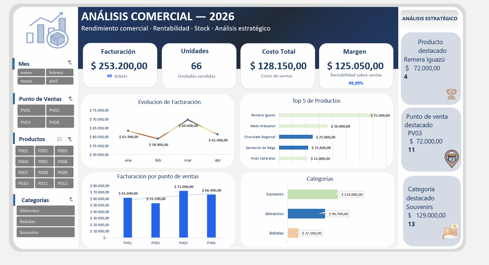

# 📊 Dashboard Comercial — Análisis de Ventas y Rentabilidad

## 📌 Descripción del proyecto

Este proyecto consiste en el desarrollo de un **Dashboard Comercial en Microsoft Excel**, orientado al análisis de ventas, costos, márgenes y rentabilidad del negocio.

El objetivo es transformar datos comerciales en información clara y útil para facilitar la toma de decisiones, identificar oportunidades de mejora y evaluar el desempeño de las categorías de productos y los puntos de venta.

El dashboard incorpora indicadores clave de rendimiento (KPIs), tablas dinámicas, gráficos y segmentadores interactivos que permiten explorar los resultados desde diferentes perspectivas.

## 🎯 Objetivos

- Analizar la facturación y el desempeño comercial.
- Calcular los costos asociados a las ventas.
- Evaluar el margen bruto y la rentabilidad.
- Comparar los resultados por categoría de producto.
- Analizar la facturación por punto de venta.
- Facilitar el análisis mediante filtros interactivos.
- Presentar la información de forma visual, organizada y comprensible.

## 🛠️ Herramientas utilizadas

- **Microsoft Excel:** preparación, cálculo y análisis de datos.
- **Tablas dinámicas:** resumen y análisis de la información.
- **Fórmulas de Excel:** cálculo de facturación, costos, margen bruto y rentabilidad.
- **Gráficos:** visualización de resultados comerciales.
- **Segmentadores de datos:** filtros interactivos para explorar la información.
- **Diseño de dashboards:** organización visual de indicadores y gráficos.

## 📈 Indicadores clave (KPIs)

El dashboard presenta los siguientes indicadores:

| Indicador                 | Resultado |
| ------------------------- | --------: |
| Facturación total         |  $253.200 |
| Costo total               |  $128.150 |
| Margen bruto              |  $125.050 |
| Rentabilidad sobre ventas |   49,38 % |
| Cantidad de tickets       |        40 |
| Unidades vendidas         |        66 |

_Los resultados corresponden a los datos analizados en el proyecto._

## 📊 Análisis realizado

### 1. Análisis de facturación

Evaluación de los ingresos generados por las ventas, con posibilidad de explorar los resultados mediante los filtros disponibles.

### 2. Análisis de costos y margen bruto

Comparación entre la facturación y los costos de los productos vendidos para determinar el margen bruto obtenido.

**Fórmula utilizada:**

Margen bruto = Facturación − Costo total

### 3. Análisis de rentabilidad

Cálculo del porcentaje de margen bruto sobre la facturación total.

**Fórmula utilizada:**

Rentabilidad (%) = (Margen bruto / Facturación) × 100

### 4. Análisis por categoría

Evaluación de las categorías de productos para identificar su participación en las ventas y su contribución al margen bruto.

### 5. Análisis por punto de venta

Comparación de la facturación entre los distintos puntos de venta para identificar diferencias en el desempeño comercial.

## 🎛️ Funcionalidades del dashboard

- Visualización de KPIs principales.
- Gráficos de facturación por punto de venta.
- Análisis de ventas por categoría de producto.
- Evolución mensual de la facturación.
- Segmentadores para filtrar los datos.
- Actualización de los indicadores y gráficos según los filtros seleccionados.

## 💡 Principales resultados

A partir de los datos analizados, se obtuvieron los siguientes resultados:

- **Facturación total:** $253.200.
- **Margen bruto:** $125.050.
- **Rentabilidad sobre ventas:** 49,38 %.
- **Categoría con mayor facturación:** Souvenirs, con $129.000.
- **Punto de venta con mayor facturación:** PV03, con $72.000.

Estos resultados permiten identificar las categorías y los puntos de venta con mayor contribución a los ingresos del negocio.

## 🧠 Habilidades aplicadas

- Análisis y transformación de datos.
- Preparación y organización de información comercial.
- Cálculo e interpretación de indicadores de negocio.
- Análisis de ventas, costos y rentabilidad.
- Creación de tablas dinámicas.
- Diseño de visualizaciones.
- Desarrollo de dashboards interactivos.
- Comunicación de resultados para la toma de decisiones.

## 🚀 Conclusión

Este proyecto demuestra la aplicación de Microsoft Excel para convertir datos comerciales en información relevante para el negocio.

Mediante indicadores, tablas dinámicas, gráficos y filtros interactivos, el dashboard permite analizar el desempeño comercial y facilita la identificación de oportunidades para mejorar la gestión de ventas y la rentabilidad.

---

**Proyecto desarrollado como parte de mi portafolio de Análisis de Datos.**

**Herramientas y funcionalidades:** Microsoft Excel | Tablas dinámicas | Gráficos dinámicos | Segmentadores de datos | KPIs | Análisis de ventas y rentabilidad.

**Área de análisis:** Ventas, costos, margen bruto y rentabilidad.

